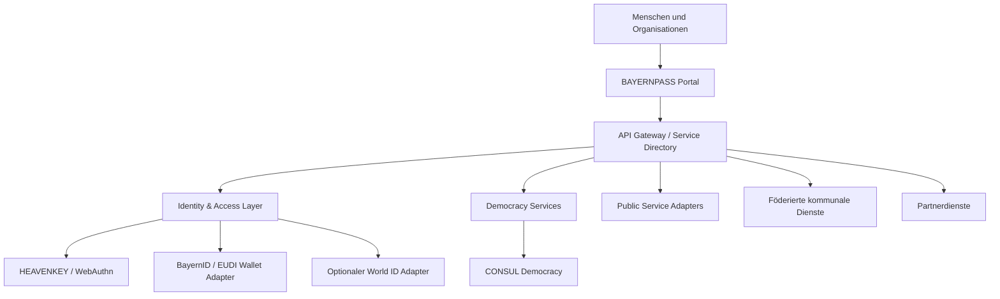

# Technische Architektur

## Zielbild

BAYERNPASS ist eine föderierte Plattform aus klar getrennten Komponenten. Das Portal ist die Nutzeroberfläche – nicht die zentrale Datenbank aller angeschlossenen Organisationen.

## Komponenten und Verantwortungsgrenzen

### 1. BAYERNPASS Portal
- Einheitlicher, barrierearmer Einstieg.
- Organisations- und dienstbezogene Navigation.
- Keine unnötige Speicherung amtlicher Identitätsdaten.
- Klare Kennzeichnung, welche Organisation einen Dienst betreibt.

### 2. HEAVENKEY / Identity & Access
- Passkeys und WebAuthn/FIDO2 als bevorzugter passwortarmer Zugang.
- OIDC/OAuth 2.1 für delegierte Anmeldung und Autorisierung.
- Rollen und Berechtigungen nach dem Least-Privilege-Prinzip.
- Recovery- und alternative Zugangswege für Menschen ohne kompatibles Gerät.

### 3. Nachweis-Adapter
- **BayernID / EUDI Wallet:** nur über offizielle, freigegebene Schnittstellen und nach rechtlicher Prüfung.
- **World ID:** optionaler Proof-of-Personhood-Adapter für eng begrenzte Anwendungsfälle. Nicht als amtlicher Identitäts-, Alters-, Wohnsitz- oder Wahlberechtigungsnachweis behandeln.
- Adapter sind austauschbar; kein Anbieter erhält eine universelle Kontrolle über den Zugang.

### 4. Demokratie / CONSUL
- Vorschläge, Debatten, Konsultationen und partizipative Budgets.
- Mandantentrennung je Organisation.
- Veröffentlichte Regeln, Fristen, Moderation und Ergebnisberichte.
- CONSUL ist ein eigenständiges Projekt; Lizenz-, Sicherheits- und Betriebsanforderungen sind vor einer Integration zu prüfen.

### 5. Föderierte Dienste
- Jede Kommune oder Organisation betreibt bzw. verantwortet ihre Fachverfahren und Daten.
- APIs übertragen nur die für einen konkreten Zweck erforderlichen Informationen.
- Protokollierung, Aufbewahrung und Zugriffsrechte bleiben beim jeweiligen Datenverantwortlichen.

## Datenfluss-Grundregeln

1. Anmeldung und fachliche Berechtigung getrennt behandeln.
2. Nur erforderliche Attribute an den Dienst übermitteln.
3. Keine globale Nutzerkennung über alle Lebensbereiche hinweg erzwingen.
4. Keine biometrischen Rohdaten in BAYERNPASS speichern.
5. Datenverantwortliche, Zwecke, Speicherfristen und Empfänger sichtbar machen.

## Technische Standards (Zielkandidaten)

- OIDC und OAuth 2.1
- WebAuthn / FIDO2
- W3C Verifiable Credentials / OpenID for Verifiable Presentations, soweit passend
- REST/JSON APIs, OpenAPI
- Containerisierte Deployments und automatisierte Tests
- WCAG 2.2 AA als Barrierefreiheitsziel

## Noch offene Architekturentscheidungen

- Frontend-Framework und Backend-Stack.
- Mandantenmodell und Hosting-/Betriebsmodell.
- Auswahl und Versionierung des CONSUL-Integrationswegs.
- Schlüsselverwaltung, Recovery und Identitätslebenszyklus.
- Datenschutz-Folgenabschätzung und Bedrohungsmodell.
- Öffentliche Governance und Lizenzmodell des Gesamtprojekts.

Diese Entscheidungen werden in Architecture Decision Records (ADRs) dokumentiert, bevor produktive Daten verarbeitet werden.
